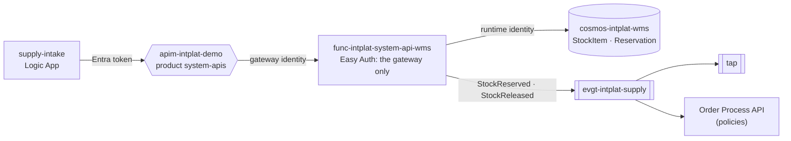

# system-api-wms

The **[Supply] WMS System API**: the simulated WMS of the supply domain, in the platform's contract. Owned by
the **supply team**. A Python Function on Flex Consumption.

| File | What |
|---|---|
| [`openapi.yaml`](openapi.yaml) | The REST contract (internal: product `system-apis`) |
| [`asyncapi.yaml`](asyncapi.yaml) | The supply facts it publishes on `evgt-intplat-supply` |
| [`wms.py`](wms.py) | WMS's own model and rules, and the mapping to the contract |
| [`function_app.py`](function_app.py) | The routes |
| [`kit.py`](kit.py) | Platform plumbing, the same in every System API: responses, journey, contract validation, Cosmos DB, facts |
| [`infra/`](infra/) | Function (Flex Consumption), storage, Easy Auth |

## Where it sits

| Operation | | Notes |
|---|---|---|
| Reserve Stock | `POST /stock-reservations` | Every line or none; 409 when stock is short. One per order. |
| Retrieve Stock Reservation | `GET /stock-reservations/{reservationId}` |  |
| Release Stock | `DELETE /stock-reservations/{reservationId}?reason=` | Soft delete: the stock is available again, StockReleased (since 1.1.0) |
| Retrieve Stock Item | `GET /stock-items/{productId}` | onHand, reserved, available |

Every write is idempotent per order where the contract says so: a retry returns what exists and
publishes nothing, so Event Grid's at-least-once delivery never creates a second sales order,
reservation or shipment.

## The contract and WMS

WMS keeps its own model ([backend-systems/wms](https://github.com/azure-intelligence-domain/backend-systems/tree/main/wms)); this API
translates. A System API translates and keeps the system's own rules; it does not decide for the
order domain.

| Contract | WMS |
|---|---|
| `reservationId` | Reservation.id (RSV-<orderId>) |
| `orderId` | orderRef |
| `orderLines[]` | lines: sku, qty |
| `lifecycleStatus` | state: RESERVED → reserved, RELEASED → released. `status` is deprecated (always reserved): adding a value to a response enum would break clients, so 1.1.0 added an extensible one |
| `productId / warehouseId` | StockItem sku / warehouse |

## Tests

`uv run --no-project --python 3.12 --with-requirements requirements.txt --with pytest pytest -q`:
the logic against an in-memory database, every operation is a function, and every published
event matches `asyncapi.yaml` and the envelope.

## Pipeline

`.github/workflows/deploy.yml`: contract check and tests, then on `main`: Bicep, code, and two
smoke tests (the Function refuses calls that skip the gateway; the gateway refuses callers without
a platform token). Ends with a deployment event.
